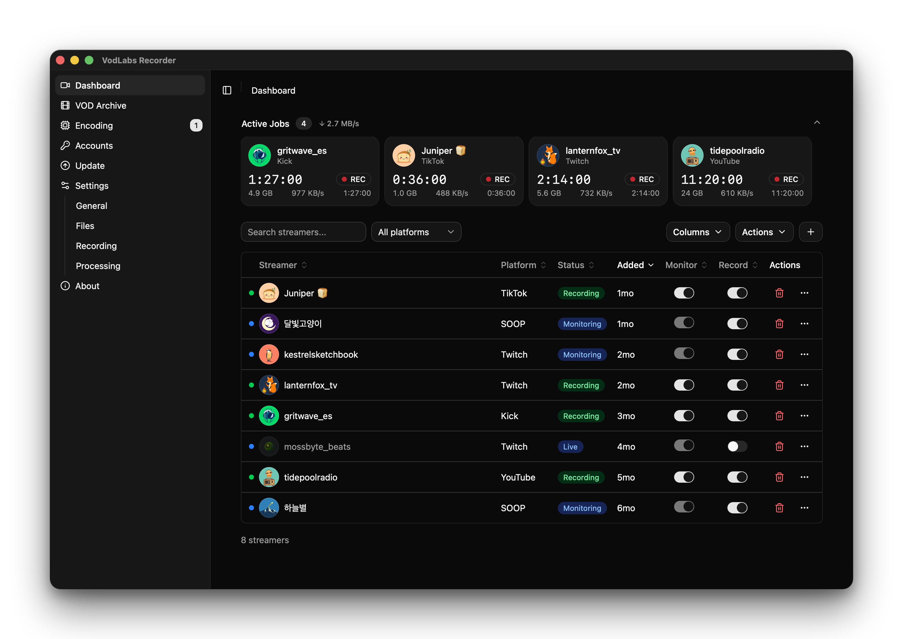

<p align="center">
  
</p>

<h1 align="center">VodLabs Recorder</h1>



Add the streamers you follow, and VodLabs Recorder records each broadcast the
moment it goes live, straight from the platform to your disk. It is a desktop
app for macOS, Windows and Linux, plus a command-line tool, `vod`.

It records from [40+ platforms](docs/platforms.md), including TikTok,
YouTube, Twitch and Kick.

## Download

| Platform | Download |
| --- | --- |
| macOS, Apple Silicon | [VodLabs-Recorder-macOS-arm64.dmg](https://github.com/vodlabs-io/recorder/releases/latest/download/VodLabs-Recorder-macOS-arm64.dmg) |
| Windows 11 | [VodLabs-Recorder-Windows-x64-Setup.zip](https://github.com/vodlabs-io/recorder/releases/latest/download/VodLabs-Recorder-Windows-x64-Setup.zip) |
| Linux, x64 | [VodLabs-Recorder-Linux-x64-Setup.tar.gz](https://github.com/vodlabs-io/recorder/releases/latest/download/VodLabs-Recorder-Linux-x64-Setup.tar.gz) |

The app updates itself. [Installing](docs/install.md) covers the first-launch
warnings on each system.

To install only the command-line tool, on macOS or Linux:

```sh
curl -fsSL https://vodlabs.io/install.sh | sh
```

On Windows, in PowerShell:

```powershell
irm https://vodlabs.io/install.ps1 | iex
```

Then see [Getting started](docs/getting-started.md).

## How it works, and what VodLabs sees

- **Recording happens on your machine.** Video goes straight from the
  platform to your disk. It never passes through VodLabs.
- **Live status updates come from the VodLabs service.** It tells your recorder when a
  streamer goes live, so the app needs it to start recordings.
- **Your platform logins never leave your device.** They are stored encrypted
  and used only on this machine.
- **The free plan is an exchange.** Your recorder also runs some live checks for 
other users, and they do the same for you. The service keeps your list of streamers, 
your IP address and your app version, to run the service fairly and to stop abuse.

[What the recorder sends to VodLabs](docs/data.md) has the details, and
links the code that does each part. The
[VodLabs privacy policy](https://vodlabs.io/privacy) covers the rest.

## Build from source

You need [Go](https://go.dev/dl/) (it fetches the exact version `go.mod`
names) and [Bun](https://bun.sh).

```sh
git clone https://github.com/vodlabs-io/recorder.git
cd recorder
./scripts/build.sh    # downloads the pinned FFmpeg, then builds ./vlrecd and ./vod
bun install
bun run dev:hmr       # the desktop app, reloading as you edit the UI
```

Builds from source use the same VodLabs service as the released app.
[CONTRIBUTING.md](CONTRIBUTING.md) covers the development setup.

## More

- [User guide](docs/README.md)
- [Contributing](CONTRIBUTING.md) and the [security policy](SECURITY.md)
- [License](LICENSE): PolyForm Noncommercial 1.0.0. [LICENSING.md](LICENSING.md)
  explains what that allows and how to get a commercial license.
- [Third-party notices](THIRD_PARTY_NOTICES.md), including the source of the
  embedded FFmpeg

VodLabs is not affiliated with, or endorsed by, any of the platforms it records
from. Their names are trademarks of their owners.
