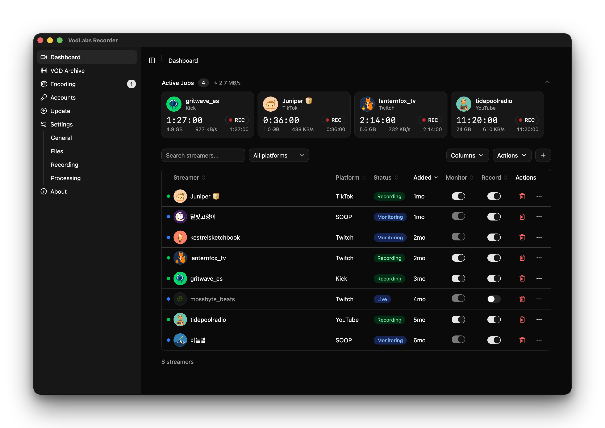

<p align="center">
  
</p>

<h1 align="center">VodLabs Recorder: free live stream recorder</h1>

<p align="center">
  Automatically record TikTok, Twitch, YouTube, Kick and 50+ more live platforms
  to your own disk. Desktop app for macOS, Windows and Linux, a CLI, and Docker.
</p>

<p align="center">
  <a href="https://github.com/vodlabs-io/recorder/releases/latest"></a>
  <a href="https://github.com/vodlabs-io/recorder/releases"></a>
  <a href="LICENSE"></a>
  <a href="https://vodlabs.io"></a>
</p>

<picture>
  <source media="(prefers-color-scheme: light)" srcset="docs/images/dashboard-light.png">
  
</picture>

Add the streamers you follow, and VodLabs Recorder records each broadcast the
moment it goes live, straight from the platform to your disk. It is free, and
its source code is public here, under the PolyForm Noncommercial license.

## Features

- **Records on its own.** Follow any number of channels; every broadcast is
  recorded from the moment it starts until it ends, then saved as one MP4.
- **56 platforms.** TikTok, Twitch, YouTube, Kick, SOOP, Bigo, Douyin,
  Instagram and more, plus about 55 partner sites. See the list below.
- **Streams that need an account.** Sign in inside the app to record
  age-restricted, subscriber-only and members-only streams on 17 platforms. Your
  login stays encrypted on your machine.
- **A searchable archive.** Search by streamer, filter by platform or date,
  preview, play, merge parts and delete in bulk.
  [More about the VOD archive](https://vodlabs.io/features/vod-archive/).
- **Picks up after a crash.** If the app restarts mid-stream, recording carries
  on in the same VOD when it's back within 15 minutes.
- **Desktop, command line or Docker.** The desktop app, the `vod`
  [command-line tool](https://vodlabs.io/features/command-line/) for scripts and
  AI agents, or a Docker image with a web interface for a server or NAS.

## Platforms

Use it as a [TikTok Live recorder](https://vodlabs.io/platforms/tiktok/), a
[Twitch stream recorder](https://vodlabs.io/platforms/twitch/), a
[YouTube live recorder](https://vodlabs.io/platforms/youtube/) or a
[Kick stream recorder](https://vodlabs.io/platforms/kick/), or for any of these:

[17LIVE](https://vodlabs.io/platforms/17live/), [Bigo](https://vodlabs.io/platforms/bigo/), [Bilibili](https://vodlabs.io/platforms/bilibili/), BuzzCast, [CHZZK](https://vodlabs.io/platforms/chzzk/), [Douyin](https://vodlabs.io/platforms/douyin/), [Douyu](https://vodlabs.io/platforms/douyu/), [FC2 Live](https://vodlabs.io/platforms/fc2live/), [Huya](https://vodlabs.io/platforms/huya/), [Instagram](https://vodlabs.io/platforms/instagram/), [Kwai](https://vodlabs.io/platforms/kwai/), [LiveMe](https://vodlabs.io/platforms/liveme/), [MICO](https://vodlabs.io/platforms/mico/), [Mixch](https://vodlabs.io/platforms/mixch/), [Niconico](https://vodlabs.io/platforms/niconico/), [Nimo TV](https://vodlabs.io/platforms/nimotv/), [PandaLive](https://vodlabs.io/platforms/pandalive/), [Peeks](https://vodlabs.io/platforms/peeks/), [PopkonTV](https://vodlabs.io/platforms/popkontv/), RPLAY, [Rumble](https://vodlabs.io/platforms/rumble/), [RUTUBE](https://vodlabs.io/platforms/rutube/), [SOOP](https://vodlabs.io/platforms/soop/), [Superlive](https://vodlabs.io/platforms/superlive/), [Tango](https://vodlabs.io/platforms/tango/), TiLive, [TwitCasting](https://vodlabs.io/platforms/twitcasting/), [VK Video Live](https://vodlabs.io/platforms/vklive/), [X](https://vodlabs.io/platforms/x/), Xiaohongshu and YouNow.

It also records 21 cam sites. [The platform list](docs/platforms.md) has all
56, which ones support signing in, and the partner sites each one covers.

## Download

| Platform | Download |
| --- | --- |
| macOS, Apple Silicon | [VodLabs-Recorder-macOS-arm64.dmg](https://github.com/vodlabs-io/recorder/releases/latest/download/VodLabs-Recorder-macOS-arm64.dmg) |
| macOS, Intel | [VodLabs-Recorder-macOS-x64.dmg](https://github.com/vodlabs-io/recorder/releases/latest/download/VodLabs-Recorder-macOS-x64.dmg) |
| Windows 11, x64 | [VodLabs-Recorder-Windows-x64-Setup.zip](https://github.com/vodlabs-io/recorder/releases/latest/download/VodLabs-Recorder-Windows-x64-Setup.zip) |
| Windows 11, Arm | [VodLabs-Recorder-Windows-arm64-Setup.zip](https://github.com/vodlabs-io/recorder/releases/latest/download/VodLabs-Recorder-Windows-arm64-Setup.zip) |
| Linux, x64 | [VodLabs-Recorder-Linux-x64-Setup.tar.gz](https://github.com/vodlabs-io/recorder/releases/latest/download/VodLabs-Recorder-Linux-x64-Setup.tar.gz) |

The app updates itself. [Installing](docs/install.md) covers the first-launch
warnings on each system.

To install only the command-line tool, on macOS or Linux (AI agents and scripts:
see [the agent guide](docs/agents.md)):

```sh
curl -fsSL https://vodlabs.io/install.sh | sh
```

On Windows, in PowerShell:

```powershell
irm https://vodlabs.io/install.ps1 | iex
```

Then see [Getting started](docs/getting-started.md).

On a server or NAS, run it in Docker, with the app's interface in your browser:

```sh
docker compose up -d   # with this repository's compose.yaml
docker compose exec recorder vod web url
```

See [Running in Docker](docs/docker.md).

## How it works, and what VodLabs sees

- **Recording happens on your machine.** Video goes straight from the
  platform to your disk. It never passes through VodLabs.
- **Live status updates come from the VodLabs service.** It tells your recorder when a
  streamer goes live, so the app needs it to start recordings.
- **Your platform logins never leave your device.** They are stored encrypted
  and used only on this machine.
- **The free plan is an exchange.** Your recorder also runs some live checks for 
other users, and they do the same for you. The service keeps your list of streamers, 
your IP address and your app version, to run the service fairly and to stop abuse.

[What the recorder sends to VodLabs](docs/data.md) has the details, and
links the code that does each part. The
[VodLabs privacy policy](https://vodlabs.io/privacy) covers the rest.

## Build from source

You need [Go](https://go.dev/dl/) (it fetches the exact version `go.mod`
names) and [Bun](https://bun.sh).

```sh
git clone https://github.com/vodlabs-io/recorder.git
cd recorder
./scripts/build.sh    # downloads the pinned FFmpeg, then builds ./vlrecd and ./vod
bun install
bun run dev:all       # the daemon and the desktop app, reloading as you edit the UI
```

Builds from source use the same VodLabs service as the released app.
[CONTRIBUTING.md](CONTRIBUTING.md) covers the development setup.

## More

- [User guide](docs/README.md), also at [vodlabs.io/docs](https://vodlabs.io/docs/)
- [Guides](https://vodlabs.io/guides/) and [what's new in each release](https://vodlabs.io/changelog/)
- [Contributing](CONTRIBUTING.md) and the [security policy](SECURITY.md)
- [License](LICENSE): PolyForm Noncommercial 1.0.0. [LICENSING.md](LICENSING.md)
  explains what that allows and how to get a commercial license.
- [Third-party notices](THIRD_PARTY_NOTICES.md), including the source of the
  embedded FFmpeg

VodLabs is not affiliated with, or endorsed by, any of the platforms it records
from. Their names are trademarks of their owners.
